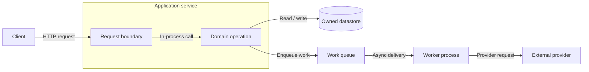
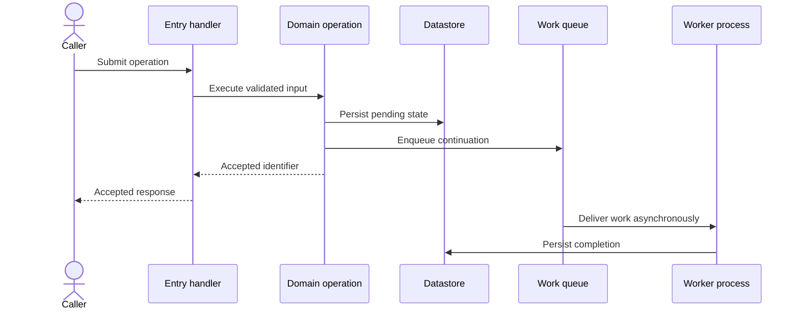

# Diagrams that explain the system

Use Mermaid diagrams embedded in Markdown so the map remains editable and reviewable with the code. Use other formats only if requested or required by the repository. Do not publish to an external diagram service by default.

## Choose views by the question

| Question | Useful view |
| --- | --- |
| What runs, and what talks to what? | Architecture flowchart grouped by process/service |
| How are responsibilities assembled? | Component flowchart grouped by domain/package |
| What happens when a capability is invoked? | Flowchart with decisions or sequence diagram with ordered calls |
| What data exists and who owns it? | Entity relationship diagram or ownership flowchart |
| How does an entity or process change state? | State diagram showing implemented transitions |

The system entry point must include an architecture diagram and a representative execution-flow diagram. Add diagrams at lower aggregation levels when they clarify behavior. Do not cram a large codebase into one graph: each parent shows its children and boundaries, with links to deeper views.

## Evidence rules

- Use repository-specific names and mechanisms. Do not infer queues, caches, services, or state transitions from framework defaults.
- Differentiate in-process calls, network calls, persistence, event publication, and asynchronous processing. Use descriptive edge labels and a legend; do not rely on color alone.
- Show external systems and ownership/process boundaries. Keep the direction of requests, responses, and events clear.
- Put an evidence legend below each diagram mapping its nodes and important edges to report sections or source paths with symbols or lines.
- Label inferred or unverified relationships on the diagram and explain the limit below it. Unresolved edges cannot become established architecture merely by appearing in a picture.
- Follow a diagram with a short prose walkthrough that explains decisions, timing, and observable results.
- Keep names consistent between diagrams, inventories, and prose. Parent views must preserve important boundaries present in child views.

## Illustrative architecture pattern

This example is fictional. Replace every node and edge with observed components; omit concepts absent from the actual repository.

An actual report must cite the route registration, domain implementation, queue producer/consumer, and provider adapter that justify these edges.

## Illustrative execution pattern

This fictional example shows why the response and later completion are distinct. Adapt the ordering, errors, and participants to source evidence.

The accompanying prose should explain when the caller sees success, what still runs afterward, and what happens if the continuation fails, as evidenced by the repository.

## Verification

Check each diagram against the relevant source and boundary reports, including direction, call ordering, ownership, conditions, and sync/async behavior. Keep node IDs simple and quote labels containing punctuation. Balance subgraph and control-block delimiters.

Render or parse diagrams with an already available validator when possible and inspect the result for legibility. Do not install dependencies solely to validate a diagram. If no renderer is available, perform a structural review and state that rendering was not verified. A valid diagram can still describe the wrong system; source verification is required independently of syntax checks.
